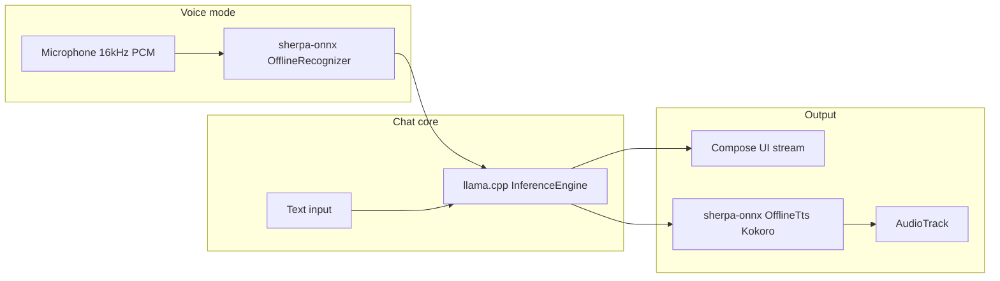

# Architecture

## Data flow



## Modules

- **`:lib`** — Upstream `llama.cpp` `examples/llama.android/lib`. CMake builds `libai-chat.so` with KleidiAI for `arm64-v8a`.
- **`:sherpa`** — JNI libs from sherpa-onnx release + Kotlin API (`com.k2fsa.sherpa.onnx`).
- **`:app`** — Compose UI, `ChatViewModel`, engine wrappers.

## Threading

- LLM load/generation: `Dispatchers.Default`
- STT/TTS init and decode: `Dispatchers.IO`
- UI updates: `Main`

## Model storage on device

```
filesDir/models/
  llm/gemma-2-2b-it-Q4_K_M.gguf
  asr/sense-voice/          # model.int8.onnx, tokens.txt
  asr/whisper-tiny.en/      # optional
  tts/kokoro-multi-lang-v1_0/
  vad/silero_vad.onnx       # optional future streaming
```

Paths are resolved in `ModelPaths.kt` and passed as absolute paths to sherpa `newFromFile` configs.

## Security

- No network permission in release manifest (models sideloaded or downloaded via separate tooling).
- All inference local; chat history stays in app private storage.
